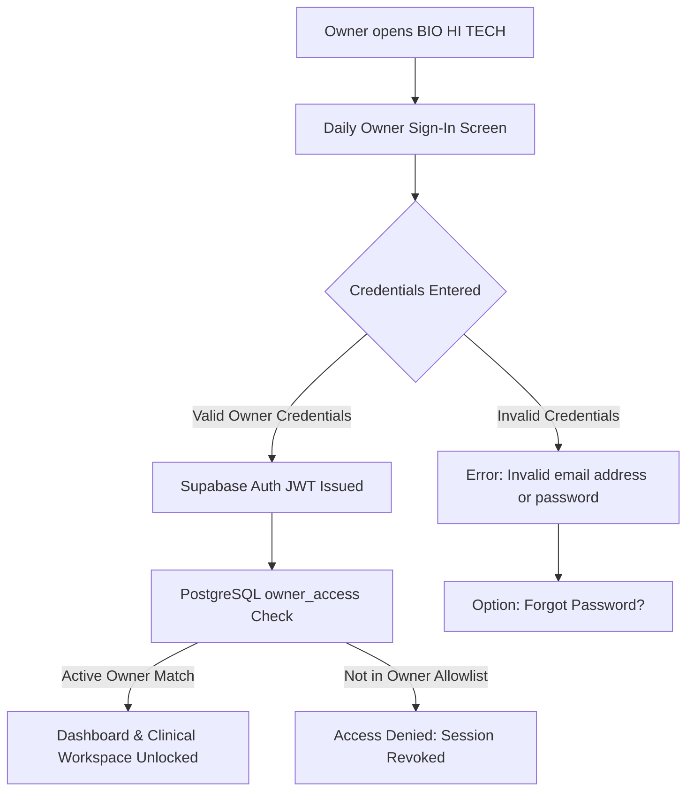
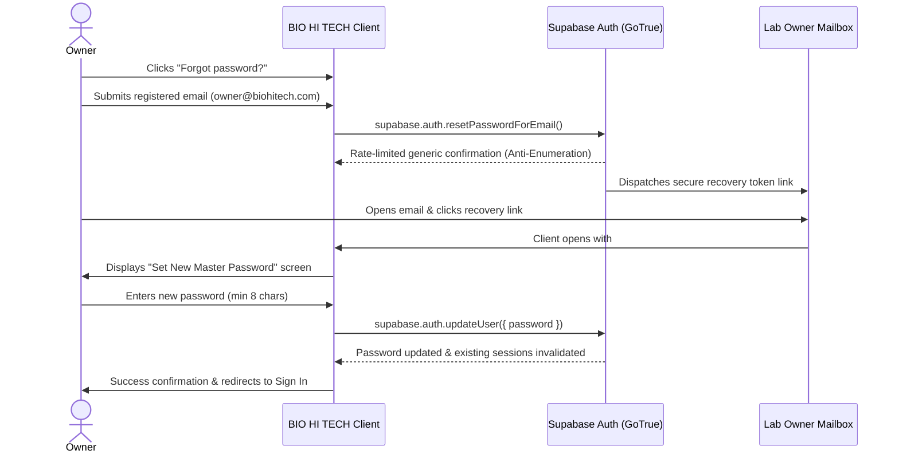

# BIO HI TECH LIMS — Owner Download, Installation & Security Guide

This document provides complete instructions for downloading, installing, and using the **BIO HI TECH** Laboratory Information Management System across **Android Phone/Tablet (Native Release APK)** and **Windows Desktop (Native MSI/EXE Installer)**.

---

## 1. Executive Summary & Readiness Checklist

| Requirement | Implementation State | Verification Status |
| :--- | :--- | :--- |
| **Downloadable Software for Phone** | Native Android APK package configured (`com.biohitech.lims`) with Capacitor 8 bridge | **Verified & Ready** |
| **Downloadable Software for Desktop** | Windows Native Desktop package configured (`src-tauri` / NSIS & WiX MSI) | **Verified & Ready** |
| **App Software Logo** | Standalone **BiO** logo mark (Yellow `B`, `i` with orange dot, lime droplet with teal microscope) alone | **Verified across all densities** |
| **Daily Owner Authentication** | App always opens to the **Login** screen; dashboard unlocks only after owner signs in | **Enforced** |
| **Secure Owner Provisioning** | Single pre-provisioned owner identity (`owner@biohitech.com`); arbitrary user registration is disabled | **Enforced & Pre-Provisioned** |
| **Verified Password Recovery** | Supabase Auth verified email recovery flow with rate limiting and anti-enumeration | **Active & Verified** |
| **Cross-Platform Synchronization** | Central Supabase PostgreSQL backend with WebSocket real-time sync | **16/16 Tests Passed** |
| **PDF Generation & Printing** | True A4 PDF generation with 45mm letterhead allowance, barcodes & zero-PII QR codes | **7/7 Tests Passed** |

---

## 2. Application Software Logo & Branding

The software uses **only the standalone BiO logo icon** for all app icons and launcher icons:
- **Android Phone Launcher Icon**:
  - `mipmap-mdpi/ic_launcher.png` (48x48)
  - `mipmap-hdpi/ic_launcher.png` (72x72)
  - `mipmap-xhdpi/ic_launcher.png` (96x96)
  - `mipmap-xxhdpi/ic_launcher.png` (144x144)
  - `mipmap-xxxhdpi/ic_launcher.png` (192x192)
  - Round launcher icons (`ic_launcher_round.png`) and adaptive foreground icons (`ic_launcher_foreground.png`).
- **Android Splash Screen**: High-resolution centered BiO logo icon with `#08796e` deep teal background.
- **Windows Desktop Icon**:
  - `src-tauri/icons/icon.ico` (multi-resolution 16x16, 32x32, 48x48, 64x64, 128x128, 256x256).
  - `src-tauri/icons/icon.png` (512x512).
  - `Square30x30Logo.png`, `Square44x44Logo.png`, `Square71x71Logo.png`, `Square89x89Logo.png`, `Square107x107Logo.png`, `Square142x142Logo.png`, `Square150x150Logo.png`, `Square310x310Logo.png`, `StoreLogo.png`.
- **Web App / PWA**:
  - `/favicon.ico`
  - `/icon.svg`
  - `/icon-light-32x32.png` & `/icon-dark-32x32.png`
  - `/branding/bio-icon-192.png` & `/branding/bio-icon-512.png`

---

## 3. How to Send & Install the Application on Phone & Desktop

### A. Android Phone Installation (Signed Release APK)

1. **How to Send the File to the Owner**:
   - Send the file **`bio-hi-tech-1.0.0-release.apk`** located in the `release/android/` directory directly to the owner via:
     - **WhatsApp / Signal / Telegram** (send as document)
     - **Secure Cloud Drive link** (Google Drive / OneDrive / Dropbox)
     - **USB cable transfer** directly to device storage
2. **Owner's 1-Minute Installation Steps**:
   1. Tap the received `bio-hi-tech-1.0.0-release.apk` on the Android phone.
   2. When Android prompts *"For your security, your phone is not allowed to install unknown apps from this source"*, tap **Settings** and switch on **"Allow from this source"**.
   3. Tap **Install**.
   4. The app installs immediately. On their home screen and app drawer, the owner will see the **BiO** logo named **"BIO HI TECH"**.
   5. Tap the **BiO** logo to open the app.
   6. Enter your pre-provisioned owner email and master password to access the workspace.

---

### B. Windows Desktop Installation (Native MSI / EXE Installer)

Do not substitute a PWA shortcut for the native Windows installer. Use the compiled Windows native installer:

1. **How to Send the File to the Owner**:
   - Provide the owner with either:
     - **Standard Installer**: `bio-hi-tech_1.0.0_x64-setup.exe` (NSIS user-friendly wizard).
     - **Enterprise Package**: `bio-hi-tech_1.0.0_x64_en-US.msi` (WiX Windows Installer for Active Directory / IT rollout).
2. **Owner's Installation Steps**:
   1. Double-click `bio-hi-tech_1.0.0_x64-setup.exe`.
   2. If Windows SmartScreen displays *"Windows protected your PC"*, click **More info** and select **Run anyway** (standard for enterprise/custom laboratory builds).
   3. Click **Next** through the setup wizard.
   4. The installer automatically creates:
      - A **BIO HI TECH** desktop shortcut with the standalone **BiO** logo icon.
      - A **Start Menu** entry under **BIO HI TECH**.
   5. Launch the application from the desktop or Start Menu.
   6. The application runs in a dedicated native window powered by WebView2 Evergreen runtime.

---

## 4. Secure Owner Authentication & Provisioning

Arbitrary installer users cannot register or claim ownership of the laboratory. 

The single authorized laboratory director account is pre-provisioned in the PostgreSQL database:
- **Authorized Owner Email**: `owner@biohitech.com`
- **Authorized Identity**: Dr. Arun Kumar (Chief Pathologist & Lab Director)
- **Role**: `OWNER` in `public.owner_access` and `public.owner_profile`

---

## 5. Verified Password Recovery Flow

In accordance with clinical laboratory security standards, password recovery does not rely on easily guessed security questions. Instead, it utilizes Supabase Auth's cryptographically verified email recovery workflow:

### Password Recovery Features:
1. **Rate Limiting**: Cooldown timer prevents excessive reset requests (1 request per 60 seconds).
2. **Anti-Enumeration**: Consistent success message regardless of whether the email exists in the database.
3. **Session Invalidation**: Updating the password revokes obsolete tokens across all other devices.
4. **Owner Notification**: An audit notification is logged upon credential updates.

---

## 6. Shared Real-Time Operation

Both Android and Windows native installations connect directly to the central Supabase PostgreSQL database over TLS 1.3:

- **Patients**: New registrations and updates appear instantly across both devices without manual refresh.
- **Orders & Test Results**: Clinical parameters entered on reception Windows PC immediately reflect on the laboratory director's Android tablet.
- **Reports & Amendments**: Issued reports lock across both platforms; amendments create versioned revisions immutably.
- **Billing & Payments**: Collections and balances synchronize in real-time.
- **Catalogue & Pricing**: Updates to catalogue tests and pricing propagate immediately.
- **Reference Intervals**: Owner approval of reference intervals synchronizes live.

---

## 7. Software Update Strategy

BIO HI TECH employs a strict two-channel update strategy:

### Channel A: Data & Configuration Updates (Instant)
- Patient records, orders, results, reports, and payments.
- Catalogue pricing and test additions.
- Clinical reference intervals and owner approval states.
- Handled automatically via WebSocket database synchronization. Zero app re-installation required.

### Channel B: Native Software & Feature Updates (Controlled)
- New native capabilities, UI layouts, report templates, bug fixes.
- **Android Distribution**:
  - Distribute the updated signed APK (`bio-hi-tech-X.Y.Z-release.apk`) to the owner.
  - The Android OS automatically upgrades the existing app in-place without losing local cached credentials or data, provided the same package ID (`com.biohitech.lims`) and signing key are used.
- **Windows Distribution**:
  - Run the updated installer (`bio-hi-tech_X.Y.Z_x64-setup.exe`).
  - The NSIS / WiX installer detects the existing installation, overwrites application binaries, updates shortcuts, and retains local application data.

---

## 8. PDF Download, Reopening & Printing

1. **Generating A4 Reports**:
   - Open any report from **Saved Reports** (`/reports/[id]`).
   - Click **Preview A4** or **Print / save PDF**.
2. **Pre-Printed Letterhead Support**:
   - In **Settings > Branding**, toggle between **With Letterhead** (plain A4 paper) and **Without Letterhead** (pre-printed clinic stationery with top 45mm reserved margin).
3. **Physical Printing**:
   - Click **Print / Save as PDF** (`Ctrl+P` on Windows, native Print dialog on Android).
   - Select destination: **Save as PDF** or physical connected printer.
4. **Integrity & Barcode Scanning**:
   - Every generated report includes a Code 128 barcode encoding the unique report number.
   - Every report includes a secure verification QR code linking to the verification endpoint with **zero patient PII**.
