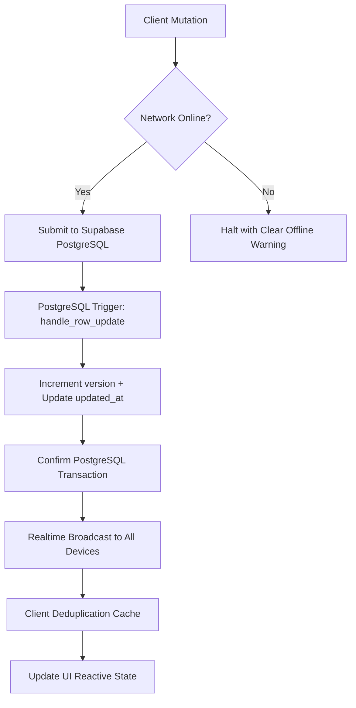

# BIO HI TECH LIMS — SUPABASE MIGRATION ARCHITECTURE REPORT

**Project**: BIO HI TECH Private Laboratory Management Software  
**Target Environment**: Development (Mumbai Region, `ap-south-1`)  
**Supabase Project Ref**: `ymwfqvyvcavsbeezweea`  
**Application Root**: `/home/mithil/Downloads/BIO-HI-TECH-LIMS/saran project/`  
**Date**: November 21, 2026  
**Status**: MIGRATIONS AUTHORIZED & COMPILED  

---

## 1. Executive Architecture Summary

The database architecture has been configured for single-tenant, owner-only laboratory operations with kernel-level Row Level Security (RLS) on PostgreSQL. It strictly guarantees that zero patient data or financial transactions can ever be accessed, modified, or deleted by unauthenticated callers, non-owner users, or unauthorized third parties.

All database objects are organized under versioned SQL migrations in [`saran project/supabase/migrations/`](file:///home/mithil/Downloads/BIO-HI-TECH-LIMS/saran%20project/supabase/migrations/) with an authoritative single-file reference snapshot in [`saran project/supabase/schema.sql`](file:///home/mithil/Downloads/BIO-HI-TECH-LIMS/saran%20project/supabase/schema.sql).

---

## 2. Versioned Migrations Manifest

| Migration File | Size | Scope & Entities | Security Features |
|---|---|---|---|
| [`20261121000001_core_laboratory_schema.sql`](file:///home/mithil/Downloads/BIO-HI-TECH-LIMS/saran%20project/supabase/migrations/20261121000001_core_laboratory_schema.sql) | 19.7 KB | 16 core tables, `uuid-ossp`, `pgcrypto`, indexes, concurrency triggers | Non-unique patient phones, optimistic locking (`version`), price snapshots |
| [`20261121000002_owner_access_and_rls.sql`](file:///home/mithil/Downloads/BIO-HI-TECH-LIMS/saran%20project/supabase/migrations/20261121000002_owner_access_and_rls.sql) | 15.1 KB | `is_active_owner()`, `claim_system_catalogue_for_owner()`, RLS policies | `uq_single_active_owner` index, 0 DELETE on reports/patients, immutable ledgers |
| [`20261121000003_storage_buckets_and_policies.sql`](file:///home/mithil/Downloads/BIO-HI-TECH-LIMS/saran%20project/supabase/migrations/20261121000003_storage_buckets_and_policies.sql) | 4.2 KB | 3 private buckets, `storage.objects` RLS policies | Zero public buckets, owner folder isolation `auth.uid()`, signed URLs |
| [`20261121000004_realtime_and_catalogue_seed.sql`](file:///home/mithil/Downloads/BIO-HI-TECH-LIMS/saran%20project/supabase/migrations/20261121000004_realtime_and_catalogue_seed.sql) | 146.1 KB | `supabase_realtime` publication, 120-test system catalogue seed | Preserves 120 legacy tests, 124 parameter specs, clinical unverified banner |

*Note: Security verification functions are maintained separately under [`supabase/tests/rls_security_test.sql`](file:///home/mithil/Downloads/BIO-HI-TECH-LIMS/saran%20project/supabase/tests/rls_security_test.sql) so that internal test-runner RPCs are not exposed over the PostgREST API.*

---

## 3. Database Entity Specifications

### Core Business Tables

1. **`owner_access`**: Allowlist table storing the authorized owner UUID (`auth.users.id`). Enforces `uq_single_active_owner` partial unique index ensuring at most one active owner exists in PostgreSQL.
2. **`owner_profile`**: Laboratory director credentials, registration number, address, and branding.
3. **`referring_doctors`**: Doctor directory with clinic, qualifications, contact details, and active status.
4. **`patients`**: Master patient index. Phone numbers are **intentionally non-unique** to accommodate family members sharing contact numbers. Features optimistic concurrency tracking via `version` column.
5. **`test_catalogue`**: 120 laboratory tests across Biochemistry, Haematology, Clinical Pathology, Microbiology, and Serology. Supports single tests and multi-parameter panels.
6. **`test_parameters`**: 124 extracted parameter specifications with data type (`Numeric`, `Qualitative`, `Text`), precision, reference ranges, and clinical governance approval flag (`is_verified = FALSE`).
7. **`reference_intervals`**: Age- and sex-stratified normal intervals, qualitative normals, and interpretation guidance notes.
8. **`laboratory_orders`**: Clinical orders linking patient, doctor, order date, status, and total billing. Supports multiple tests per order.
9. **`order_tests`**: Order line items capturing historical price snapshots at the time of order creation.
10. **`reports`**: Formal diagnostic reports with financial tracking (`subtotal_amount`, `discount_amount`, `final_amount`, `paid_amount`, `payment_status`).
11. **`report_versions`**: **Immutable** version snapshots of issued reports storing frozen JSONB payloads (`snapshot_data`) and PDF storage paths.
12. **`report_results`**: Specific parameter results (`result_value`, `unit`, `flag`, `reference_interval`). Unique constraint on `(report_id, test_name, parameter_name)`.
13. **`payment_transactions`**: **Immutable** financial transaction ledger. Tracks receipt ID, payment method (`Cash`, `UPI`, `Card`, `Bank transfer`, `Cheque`), reference numbers, and timestamps.
14. **`file_metadata`**: Secure file index tracking private storage paths, SHA-256 checksums, encryption flags, and mime types.
15. **`audit_logs`**: **Immutable** chronological audit log capturing system events (`LOGIN`, `LOGOUT`, `CREATE`, `UPDATE`, `DELETE`, `VIEW_REPORT`, `PRINT_REPORT`, `EXPORT_DATA`).
16. **`lab_settings`**: Key-value JSONB settings for application configuration, printer defaults, and letterhead margins.

### Compatibility Views
For backward compatibility across data access layers, the following views are maintained:
- `public.payments_ledger` → alias for `public.payment_transactions`
- `public.lab_orders` → alias for `public.laboratory_orders`
- `public.test_results` → alias for `public.report_results`
- `public.file_attachments` → alias for `public.file_metadata`

---

## 4. Concurrency & Temporal Governance



---

## 5. Deployment & Execution Instructions

The migrations can be pushed using the Supabase CLI or applied directly via the Supabase Dashboard SQL Editor:

### Method A: Supabase Dashboard SQL Editor (Recommended)
1. Open the [Supabase Dashboard](https://supabase.com/dashboard/project/zxcnnbugchxchjwxvale/sql/new).
2. Copy and paste the consolidated script from [`supabase/schema.sql`](file:///home/mithil/Downloads/BIO-HI-TECH-LIMS/saran%20project/supabase/schema.sql).
3. Execute the script.

### Method B: Supabase CLI
```bash
cd "saran project"
pnpm exec supabase link --project-ref zxcnnbugchxchjwxvale
pnpm exec supabase db push --remote
```
